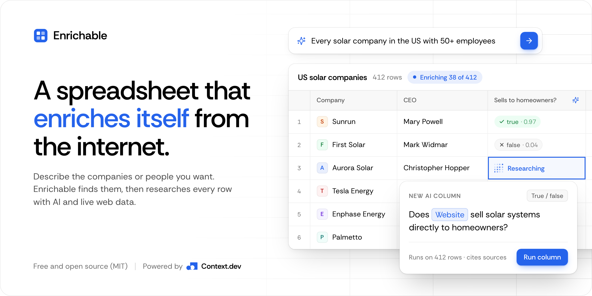

<p align="center">
  <a href="https://www.enrichable.io"></a>
</p>

<p align="center">
  <a href="https://link.context.dev/enrichable/github/context">
    <picture>
      <source media="(prefers-color-scheme: dark)" srcset=".github/assets/powered-by-context-dark.png" />
      
    </picture>
  </a>
</p>

<p align="center">
  <a href="https://www.enrichable.io"><strong>Website</strong></a> ·
  <a href="#self-host">Self-host</a> ·
  <a href="docs/usage.md">Docs</a> ·
  <a href="docs/mcp.md">MCP</a> ·
  <a href="https://github.com/context-dot-dev/enrichable/issues/new/choose">Report an issue</a>
</p>

<p align="center">
  <a href="LICENSE"></a>
  <a href="https://github.com/context-dot-dev/enrichable/actions/workflows/ci.yml"></a>
  <a href="docs/mcp.md"></a>
</p>

> **Built by [Context.dev](https://link.context.dev/enrichable/github/context)**, the web context API for software and AI agents. One API for search, scraping, and company and people data. Every lookup in Enrichable runs on it, so this repo doubles as a working reference for building your own research tools. [Get an API key](https://link.context.dev/enrichable/api-keys).

**Enrichable is an open-source AI spreadsheet for data enrichment.** Describe the companies or people you want and it finds them. Then add a column with a plain-English question and it researches every row on the live web: pricing pages, CEOs, tech stacks, work emails, anything public. Every answer keeps its sources.

Use it free at [enrichable.io](https://www.enrichable.io), or run your own copy with your own API keys.

## Features

- **Lead lists from a prompt.** "Every solar company in the US with 50+ employees." Rows stream in, deduplicated by domain.
- **AI research columns.** "Who is the CEO?" "Does the pricing page offer a free tier?" Each answer links to its sources.
- **Checks, categories and scores.** True/false, category and score columns, each with a probability or confidence.
- **Work email waterfall.** Tries Hunter, Prospeo, Apollo, QuickEnrich and ContactOut in your order and keeps the first hit.
- **Emails and documents.** A personalized email draft or branded PDF for every row.
- **Real formulas.** Excel-style functions run locally in the browser, with no API calls.
- **Export.** CSV, Excel or JSON, with or without confidence and sources.
- **MCP server.** Claude Code, Cursor and other MCP clients can read, edit and enrich your sheets.

## How it works

1. **Find rows.** Describe what you want, import a CSV, or start blank.
2. **Add AI columns.** Ask a question and reference other columns with `{{Website}}`. Enrichable picks the operation: web research, a page read, a company or person lookup, or an email search.
3. **Review and export.** Open any cell to see its sources and confidence, rerun or edit it, filter what passes, and export.

[Context.dev](https://link.context.dev/enrichable/github/context) handles the web (search, scraping, company and people data). OpenAI does the reasoning. [TypeSafe](https://typesafe.ai) makes calibrated true/false and category calls when you connect it.

## Self-host

### Deploy to Vercel

[](https://vercel.com/new/clone?repository-url=https%3A%2F%2Fgithub.com%2Fcontext-dot-dev%2Fenrichable&products=%5B%7B%22type%22%3A%22integration%22%2C%22integrationSlug%22%3A%22neon%22%2C%22productSlug%22%3A%22neon%22%2C%22protocol%22%3A%22storage%22%7D%5D)

1. Click the button and choose where to clone the repo.
2. Create a Neon Postgres database in the setup flow.
3. Deploy. The build creates the tables.
4. Open `/app` on your deployment and add your API keys.

Using an existing database, or stuck? See the [deployment guide](docs/deploy.md).

### Run locally

You need Node.js 22 (see `.nvmrc`) and a [Neon](https://neon.tech) database.

```bash
git clone https://github.com/context-dot-dev/enrichable
cd enrichable
nvm use
npm ci
cp .env.example .env.local   # set DATABASE_URL
npm run db:migrate
npm run dev
```

Open [localhost:3000/app](http://localhost:3000/app) and add your keys.

## API keys

Bring your own keys. Usage is billed to your provider accounts. Add them in the app under **Configuration → Connections**.

| Provider | Used for | |
| --- | --- | --- |
| [Context.dev](https://link.context.dev/enrichable/api-keys) | Web search, scraping, company and people data | Required |
| [OpenAI](https://platform.openai.com/api-keys) | AI columns, Find rows and column setup | Required |
| [TypeSafe](https://typesafe.ai) | Calibrated true/false, category and score columns (falls back to OpenAI) | Optional |
| [Hunter](https://hunter.io/api-keys), [Prospeo](https://app.prospeo.io/), [Apollo](https://developer.apollo.io/), [QuickEnrich](https://app.quickenrich.io/settings/api-key), [ContactOut](https://contactout.com/api) | Work emails in the [email waterfall](docs/email-enrichment.md) | Optional |

Keys you enter stay in your browser and are only sent to your deployment's API routes. For a private team deployment, set the provider variables (`OPENAI_API_KEY`, `CONTEXT_DEV_API_KEY`, and so on) on the server together with `ENRICHABLE_PASSWORD`. [.env.example](.env.example) lists every option.

## Good to know

- **Storage.** Sheets live in your Neon database, cached in the browser with IndexedDB.
- **Access.** Each browser gets a private workspace tied to a cookie. Self-hosted copies have no accounts, so export sheets to move them between browsers. To keep an instance private, restrict access at your host or network.
- **Limits.** 10 sheets per workspace and 1,000 rows per sheet. Change them in [workspace.ts](src/lib/workspace.ts).
- **Search engines.** Self-hosted copies are `noindex` unless you set `ENRICHABLE_ALLOW_INDEXING=true`.
- **Analytics.** Off unless you set `NEXT_PUBLIC_DATABUDDY_CLIENT_ID`. It never sends sheet contents, prompts or keys.

## Docs

| Guide | Covers |
| --- | --- |
| [Usage](docs/usage.md) | Column operations, formulas, selection, undo and providers |
| [MCP](docs/mcp.md) | Connecting Claude Code, Cursor or any MCP client |
| [Deploy](docs/deploy.md) | Vercel and Neon setup, existing databases, troubleshooting |
| [Email enrichment](docs/email-enrichment.md) | The email provider waterfall |
| [Realtime](docs/realtime.md) | Live collaboration with Neon Realtime |
| [Development](docs/development.md) | Architecture, tests and migrations |

Built with Next.js 16, React 19, TypeScript, Tailwind CSS 4, Neon Postgres, Dexie, IronCalc, the Vercel AI SDK and the Model Context Protocol.

## Contributing

Bug reports and feature ideas are welcome. [Open an issue](https://github.com/context-dot-dev/enrichable/issues/new/choose). We build accepted issues ourselves and don't take external pull requests, but you're welcome to fork, customize and self-host. See [CONTRIBUTING.md](CONTRIBUTING.md).

Found a vulnerability? Please report it privately as described in [SECURITY.md](SECURITY.md).

## License

[MIT](LICENSE). Bundled code, fonts and assets are listed in the [third-party notices](THIRD_PARTY_NOTICES.md).

---

<p align="center">
  <sub>Made in NYC and SF by <a href="https://github.com/YahiaBakour">@YahiaBakour</a> and <a href="https://github.com/nikhilrado">@nikhilrado</a> with the <a href="https://link.context.dev/enrichable/github/context">Context.dev</a> team.</sub>
</p>
