<p align="center">
  
</p>

<p align="center">
  Powered by
  <a href="https://looot.ai"> looot</a>
  +
  <a href="https://moltsets.com"> MoltSets</a>
</p>

<p align="center">
  <a href="LICENSE"></a>
  <a href="docs/mcp.md"></a>
  <a href="#self-hosting"></a>
</p>

# looot tables: open-source enrichment spreadsheet and Clay alternative

looot tables is an open-source enrichment spreadsheet, MIT licensed, that you can self-host on Node 22 and Postgres. Describe the companies or people you want and it finds the rows, or import a CSV. Each new column then fills every row with a work email, a phone number, company data or an AI research answer. It is an open-source alternative to Clay and Loopster for teams who build and enrich lead lists.

Every cell is a [looot](https://looot.ai) job with a receipt: the providers looot tried, in order, with the price and time of each. Contact columns run as a waterfall, so looot asks the next provider only after a miss. With a [MoltSets](https://moltsets.com) plan, from $29/mo, work email columns ask MoltSets first at $0 per row and send only the misses to looot; phone columns use MoltSets phone tokens first. Before a run, the Run button shows the most it can cost, and each sheet starts with a $5.00 cap you can raise.

## Tour

Every screenshot below comes from a production build running against the local stand-ins in `scripts/`. The ten companies and their logos are real. The people are fictional, and every email, phone, headcount, funding figure and price is invented by the stand-ins.

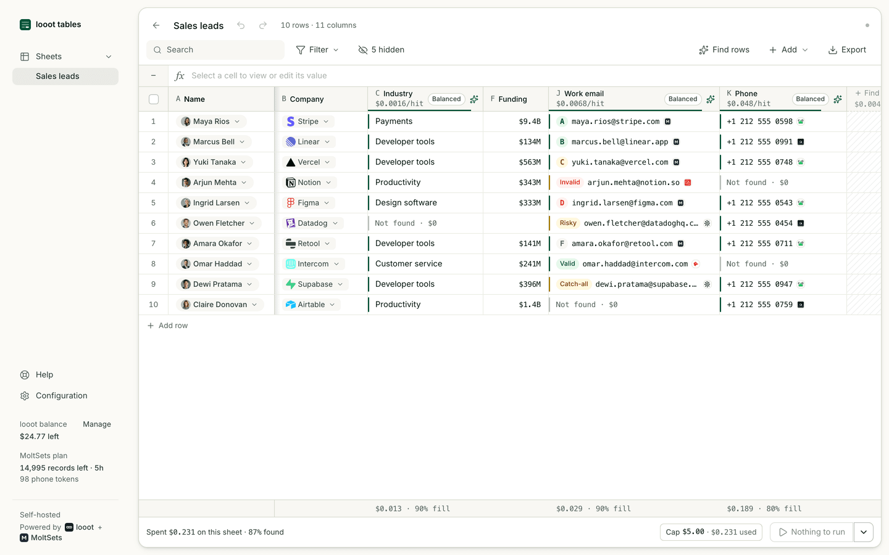

Ten contacts at ten companies, with Industry, Funding, Work email and Phone filled in. Each email cell shows a grade (A to F from MoltSets, or Valid, Risky, Catch-all and Invalid from a looot check) and the logo of the provider that answered. The bottom bar reads "Spent $0.231 on this sheet · 87% found" next to the sheet's cap, "Cap $5.00 · $0.231 used".

### Find rows

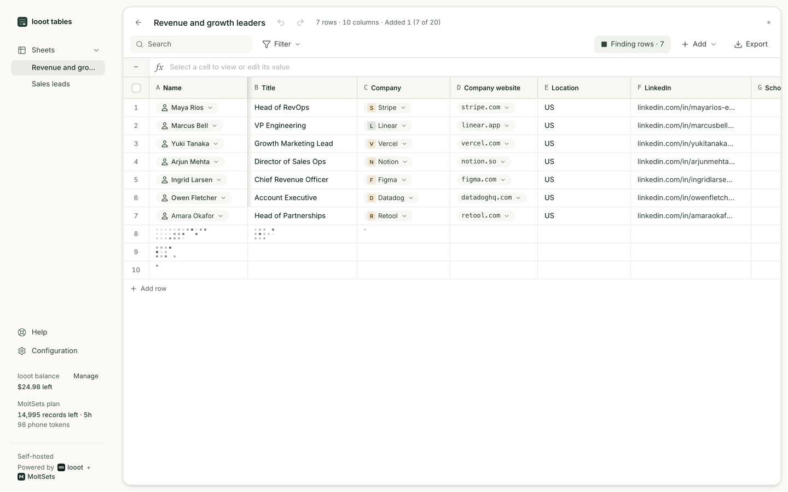

Type "Revenue and growth leaders at developer-tools and SaaS companies in the US", pick People, and press the arrow. The model finds companies through the looot `company.search` job, then people at each one through `people.search`, and rows stream in with name, title, company, website and LinkedIn. The header counts them as they land ("Added 1 (7 of 20)").

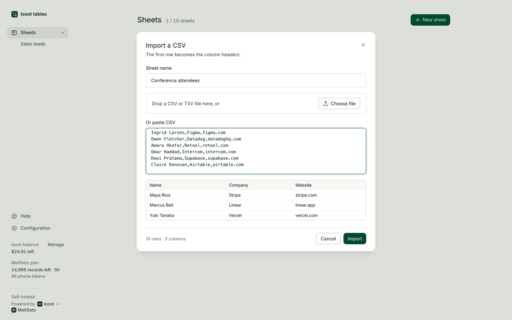

Or start from a list you already have. Drop or paste a CSV, name the sheet, and the dialog previews the first rows and counts them ("10 rows · 3 columns") before you import. The first row becomes the column headers.

### Research

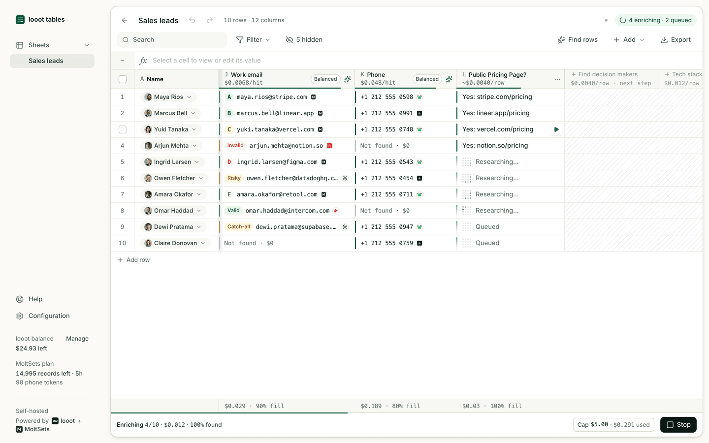

An AI column asks "Does {{Company}} publish a public pricing page?" for every row. Four cells show "Researching…" at a time (the parallel setting), the rest wait as "Queued", and finished rows already show answers such as "Yes: stripe.com/pricing". The header shows the estimate, about $0.0040 per row.

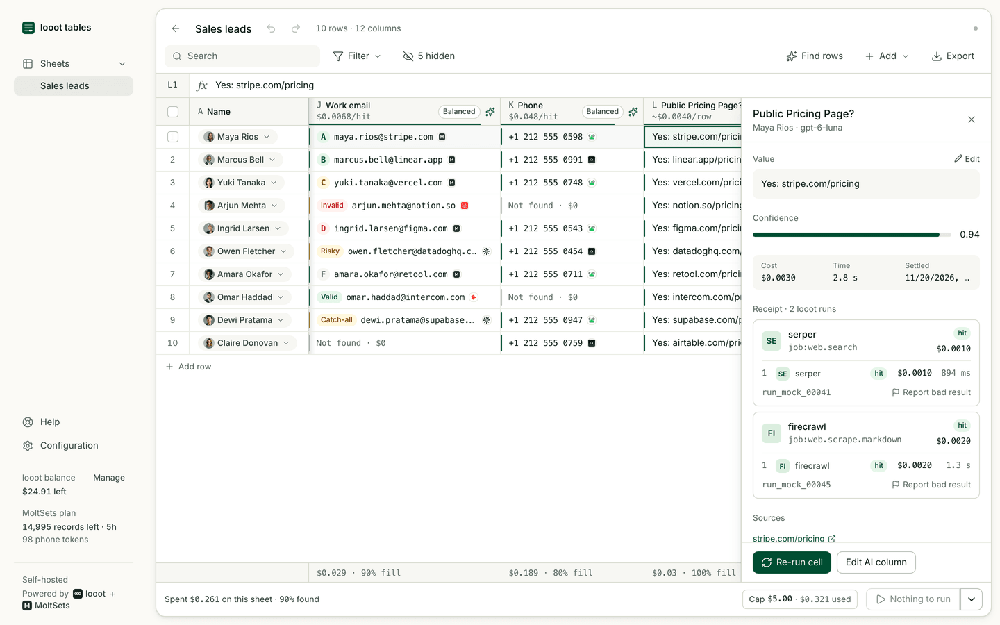

Open a finished cell to see the answer, a 0.94 confidence, the cost ($0.0030) and the time (2.8 s). The receipt lists the two looot runs behind it, a `web.search` for $0.0010 and a `web.scrape.markdown` page read for $0.0020, and the source link the answer cites.

### Contact data: MoltSets first, then looot

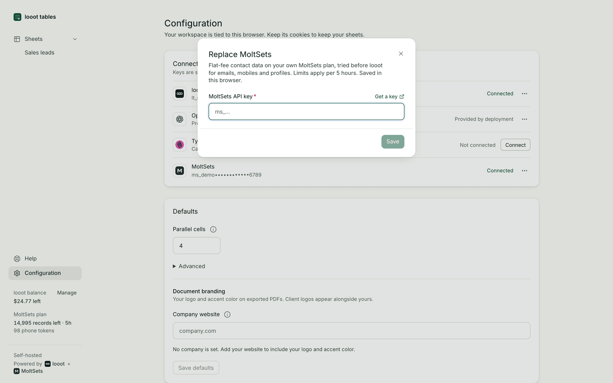

Configuration lists each connection: looot and MoltSets keys saved in this browser, OpenAI from the deployment, TypeSafe not connected. "Replace key" opens this dialog for a MoltSets `ms_` key. Once a key is connected, the sidebar shows the records left in the current 5 hour window (14,995) and the phone tokens left (98) under the looot balance.

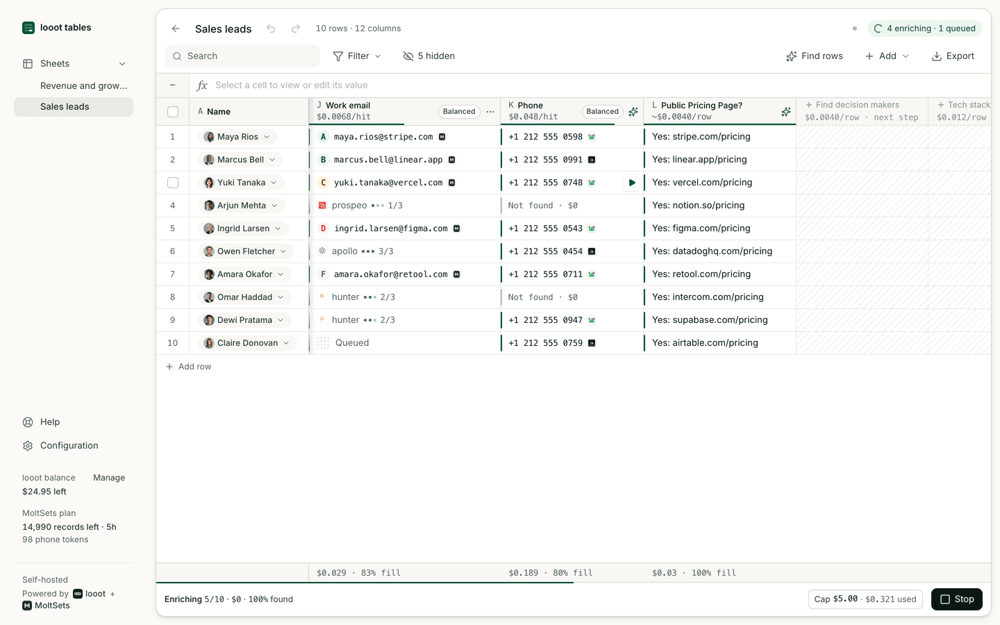

The Work email column filling. Rows MoltSets answered are done right away; the others walk looot's email providers, and each running cell shows the provider it is asking and its step ("apollo 3/3", "hunter 2/3"). The bottom bar reads "Enriching 5/10" and a Stop button ends the run.

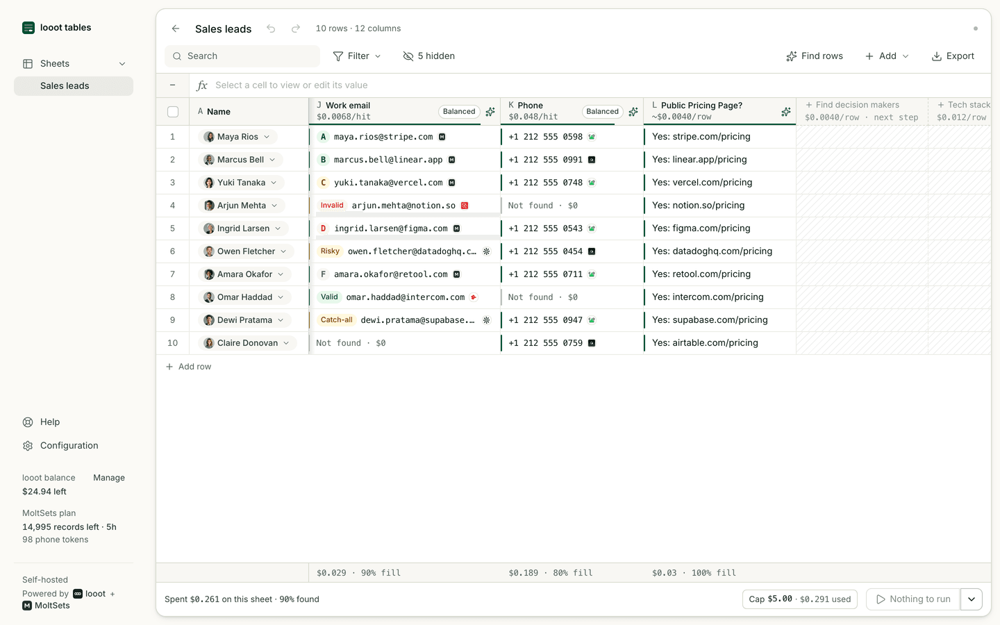

Emails MoltSets found carry its risk grade: A and B green, C amber, D red, F grey. Emails looot found are checked in the same cell and show Valid, Risky, Catch-all or Invalid. The logo at the end of each cell is the provider that answered, and a miss reads "Not found · $0" when nothing was charged.

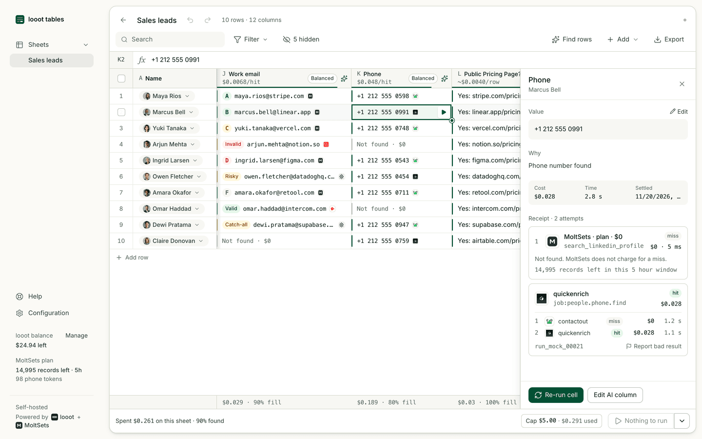

A phone cell's receipt. MoltSets could not match a LinkedIn profile ($0), then looot asked ContactOut (miss, $0, 1.2 s) and QuickEnrich, which found the number for $0.028 in 1.1 s.

### Cost and control

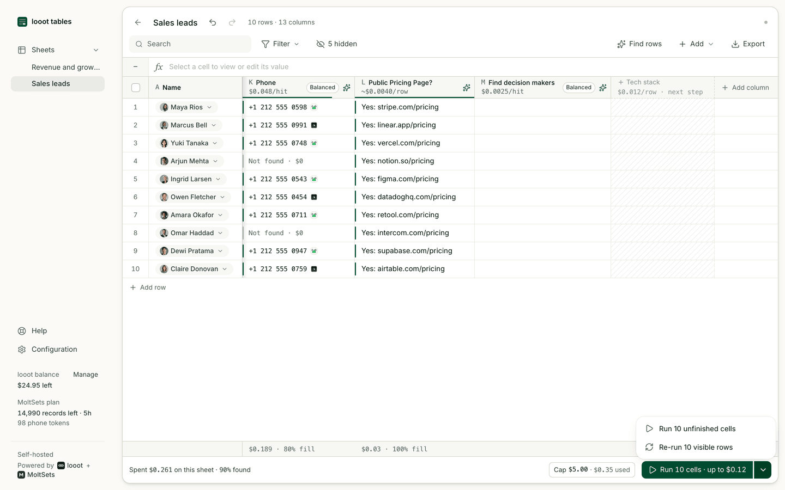

Before anything runs, the Run button says what it will do and the most it can cost: "Run 10 cells · up to $0.12". The menu next to it runs only unfinished cells or re-runs the visible rows, and the box beside it shows the sheet's cap and what it has used ("Cap $5.00 · $0.35 used").

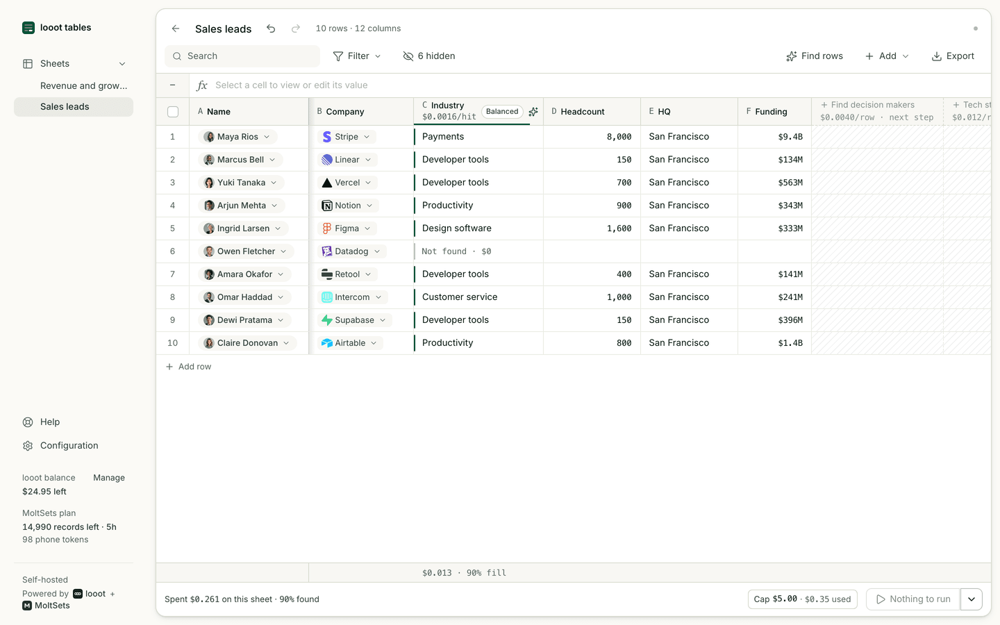

One company lookup per row filled Industry. Headcount, HQ and Funding were unpacked from the answers it already holds, so they ran nothing and cost $0. The two faint columns on the right are next steps looot suggested, "Find decision makers $0.0040/row" and "Tech stack $0.012/row". Neither runs until you click it.

### Receipts and routing

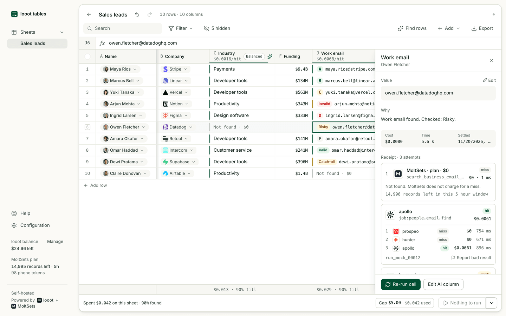

Open any cell for its receipt. Here MoltSets had no address on the plan ($0, "MoltSets does not charge for a miss", 14,996 records left this window). looot then asked prospeo (miss, $0, 754 ms) and hunter (miss, $0, 671 ms), and apollo found it for $0.0061 in 896 ms. A verify run follows below it, and every run has a "Report bad result" link.

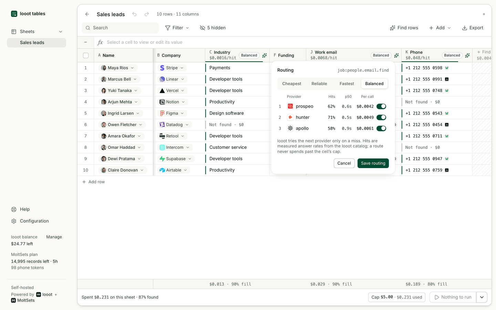

The "Balanced" pill on a column header opens its routing. Pick Cheapest, Reliable, Fastest or Balanced, see each provider's hit rate, median time and price per call (prospeo 62%, 0.6 s, $0.0042), and switch a provider off to skip it. looot asks the next provider only after a miss.

### Self-host and MCP

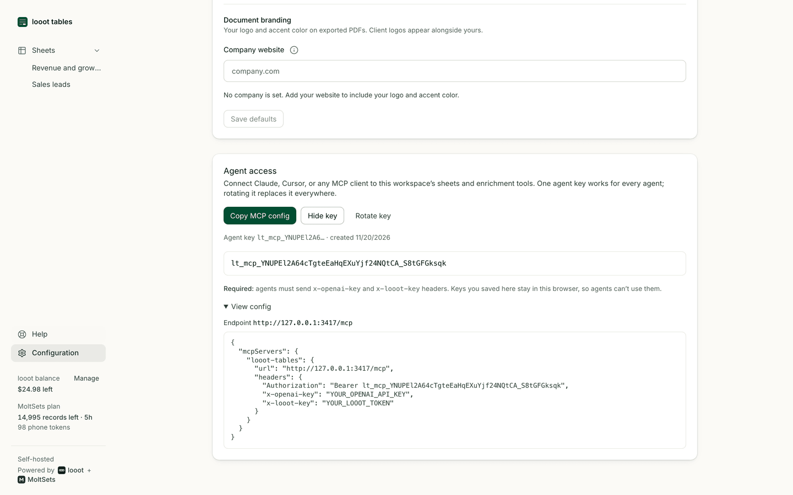

Configuration → Agent access creates one agent key for the workspace and shows the config to paste into Claude Code, Cursor or another MCP client. On a self-hosted copy the agent also sends `x-openai-key` and `x-looot-key` headers, because keys saved in the browser never leave it.

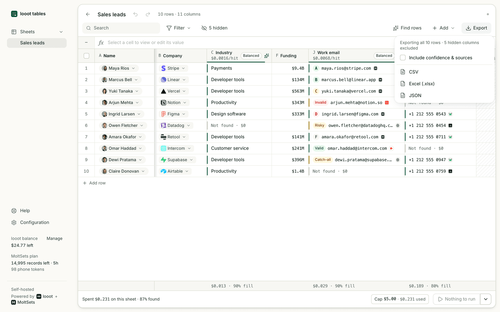

Export the sheet as CSV, Excel or JSON, with or without each cell's confidence and sources. Hidden columns stay out ("Exporting all 10 rows · 5 hidden columns excluded").

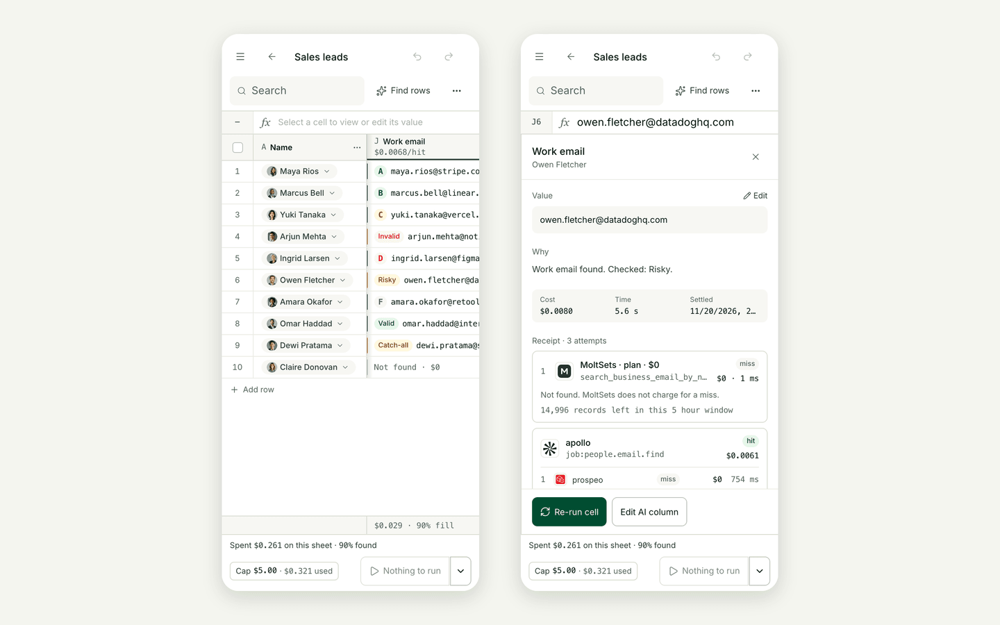

On a 390px phone the sheet keeps search, Find rows, the spend line and the Run button, and a cell's receipt opens as a full-width panel.

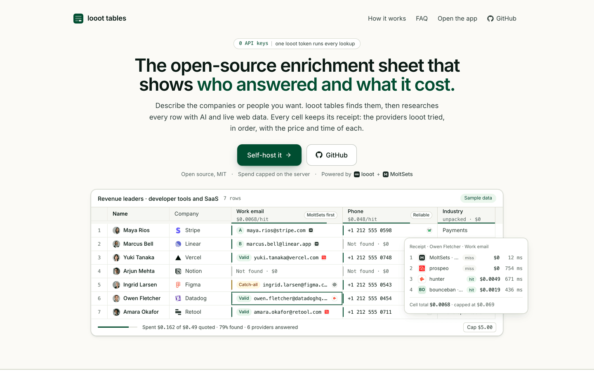

The landing page that ships with the app. Its hero sheet and receipt fit above the fold at 1440 by 900.

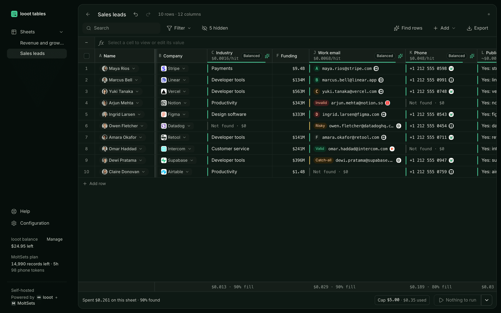

The same sheet in dark mode, which follows your system setting.

## Open-source Loopster alternative: MoltSets + looot

Loopster sells a table of enrichment columns for a flat monthly fee. looot tables gives you the table for $0 under MIT. For contact data you can bring a MoltSets plan, from $29 a month, which charges a flat fee with limits per window. Everything else goes to looot, which bills each hit to a prepaid balance.

Prices read 2026-11-20 from their public pricing pages. Both vendors change them, so check before you decide.

| | Loopster | MoltSets |
| --- | --- | --- |
| Plans | Launch $179/mo, Scale $449/mo, Unlimited $1,299/mo | Solo $29/mo, Pro $97/mo, plus a free tier and larger plans |
| Limits | Requests per day | Records and requests per rolling 5 hours and per week |
| Work emails | In the plan | $0 per row on the plan |
| Mobiles | On Scale and Unlimited | Not in the plan. Separate phone tokens, from $27 for 180 ($0.15 each) |

An example. A team finds about 10,000 work emails and 2,000 mobiles a month.

| | Loopster Scale | MoltSets + looot + looot tables |
| --- | --- | --- |
| Table | In the plan | $0 (MIT) |
| Flat fee | $449/mo | From $29/mo on MoltSets Solo. Pro is $97/mo for bigger windows |
| 10,000 work emails | In the plan | $0 per row on MoltSets while the window has room. Misses go to the looot email job, billed per hit |
| 2,000 mobiles | In the plan | About $300 in phone tokens at $0.15 each, or the looot phone job billed per hit |
| Everything else | Loopster's vendor wallet | looot jobs, billed per hit |

looot prices differ by provider and change, so the table shows no looot total. The app quotes the most a run can cost before it starts.

How the contact columns use MoltSets:

- A work email or phone column has a source setting: "MoltSets then looot" (the default once a key is connected), "looot only" or "MoltSets only".
- A MoltSets hit is the answer and looot is never called. A not_found, a used-up window, spent phone tokens or an error sends the row to the looot job. The receipt shows the MoltSets attempt at $0 first, then each looot attempt with its price.
- After MoltSets reports a used-up window, the app stops asking it until the window reopens and sends those rows to looot.
- MoltSets finds a mobile from a LinkedIn URL. Without one, it first looks up the profile by name and company, and uses it only if it is the single match or carries the same name.
- Columns that ask MoltSets first run cell by cell. Columns set to "looot only" with 10 cells or more go to looot in batches of up to 500 rows.

MoltSets people search, company search and personal email are not wired into columns yet.

## Quick start

You need Node.js 22 (`.nvmrc` pins 22.23.4), a Postgres database, a funded looot token and an OpenAI key.

```bash
git clone https://github.com/loootai/looot-tables
cd looot-tables
nvm use
npm ci
cp .env.example .env.local   # set DATABASE_URL, e.g. postgres://localhost:5432/looot_tables
npm run db:migrate
npm run dev
```

Open [localhost:3000/app](http://localhost:3000/app). The setup dialog asks for your looot token and OpenAI key, plus a MoltSets key if you have one. Keys you enter stay in your browser and go only to your own deployment's API routes.

### Try it with no keys

The stand-ins answer like looot, OpenAI and MoltSets with invented data, and no call costs money. You still need the Postgres database from above.

```bash
node scripts/mock-looot.mjs --openai   # looot on :4546, an OpenAI-compatible model on :4545
node scripts/mock-moltsets.mjs         # MoltSets on :4547

LOOOT_API_URL=http://127.0.0.1:4546 \
MOLTSETS_API_URL=http://127.0.0.1:4547 \
OPENAI_BASE_URL=http://127.0.0.1:4545/v1 \
OPENAI_API_KEY=sk-local \
LOOOT_TABLES_ALLOW_SERVER_KEYS_WITHOUT_PASSWORD=true \
npm run dev
```

Enter any looot token and any key that starts with `ms_`. The looot stand-in starts with a $25 balance and walks fallback routes across several providers. The MoltSets stand-in finds work emails for Maya Rios, Marcus Bell, Yuki Tanaka, Ingrid Larsen and Amara Okafor (grades A, B, C, D and F), returns not_found for other names so the looot fallback runs, and answers any name starting with "Spent" as a used-up window. `scripts/mock-looot.mjs` lists the demo companies and contacts. The app accepts these loopback addresses only outside production, unless `LOOOT_TABLES_ALLOW_LOCAL_BASE_URL=true`.

## How costs and caps work

- **Quote before the run.** The Run button carries the most a run can spend, such as "Run 10 cells · up to $0.12". Runs above $0.50 or 50 cells ask you to confirm.
- **Cap per cell.** Each cell is sent with `fallback.maxCostUsd` set to three times the column's usual price, so a fallback route has room for a few providers and no more.
- **Cap per sheet.** Every sheet starts with a $5.00 cap. The server holds a cell's cap before sending it and refuses any cell that would take the sheet past the cap. You can raise it.
- **Halt after 20 misses.** A column stops after 20 misses or errors in a row. Check its inputs, then resume it.
- **Try 5 rows.** A new column offers "Try 5 rows" before the whole column.
- **Receipt per cell.** Open a cell to see the outcome, each provider attempt with its price and time, and the run id. A miss shows the amount looot charged for it, which is $0 when no provider billed.
- **No double charge.** Each cell attempt keeps one idempotency key for all its retries, so a resend after a timeout gets the run looot already has.

## Self-hosting

Any Postgres works. The app uses Neon's driver for `*.neon.tech` hosts and the normal Postgres driver for everything else. Run `npm run db:migrate` before you start the app; the tables live in the `looot_tables` schema. On Vercel, `vercel.json` runs the migrations before each production build. See the [deployment guide](docs/deploy.md).

Each browser gets a private workspace tied to a cookie. A workspace holds up to 10 sheets of 1,000 rows each, set in [src/lib/workspace.ts](src/lib/workspace.ts). Self-hosted copies have no accounts, so restrict access at your host or network to keep an instance private.

### Environment variables

[.env.example](.env.example) lists every option with comments.

| Variable | What it does |
| --- | --- |
| `DATABASE_URL` | Postgres connection string. Required. |
| `DATABASE_DRIVER` | `neon` or `postgres` to force a driver. |
| `LOOOT_TABLES_MCP_ENCRYPTION_SECRET` | 32+ random characters. Encrypts MCP keys and saved provider keys. Keep it identical on every server that shares the database. |
| `LOOOT_TOKEN` | Server-side looot token. Every run is billed to its balance. |
| `OPENAI_API_KEY` | Server-side OpenAI key. |
| `TYPESAFE_API_KEY` | Optional server-side TypeSafe key for true/false and category columns. |
| `MOLTSETS_API_KEY` | Optional server-side MoltSets key. Contact columns try it before looot. |
| `LOOOT_TABLES_PASSWORD` | The server-side keys above are used only when the browser sends this password. |
| `LOOOT_TABLES_ALLOW_SERVER_KEYS_WITHOUT_PASSWORD` | `true` lets anyone with the URL spend the server keys. Off by default. |
| `LOOOT_API_URL` | Reach looot through a proxy or a stand-in instead of `https://api.looot.ai`. |
| `MOLTSETS_API_URL` | Reach MoltSets through a proxy or a stand-in instead of `https://api.moltsets.com`. The MoltSets key goes only to this address. |
| `OPENAI_BASE_URL` | An OpenAI-compatible server, used with the server-side OpenAI key. |
| `LOOOT_TABLES_ALLOW_LOCAL_BASE_URL` | `true` allows a loopback or private base URL in production. |
| `OPENAI_MODEL` | Default model when the browser does not pick one. |
| `NEON_REALTIME_URL`, `NEON_REALTIME_SECRET`, `LOOOT_TABLES_REALTIME_ENABLED` | Live updates through Neon Realtime. Without them the app polls every 30 seconds. See [docs/realtime.md](docs/realtime.md). |
| `NEXT_PUBLIC_SITE_URL` | Public origin for canonical and Open Graph URLs. |
| `LOOOT_TABLES_ALLOW_INDEXING` | `true` lets search engines index the deployment. Off by default. |
| `NEXT_PUBLIC_DATABUDDY_CLIENT_ID` | Optional product analytics. Never sends sheet contents, prompts or keys. |

### MCP server

The app serves a Streamable HTTP MCP endpoint at `/mcp`. Claude Code, Cursor and other MCP clients can read, edit and enrich your sheets with an agent key from Configuration → Agent access. Setup and tools are in [docs/mcp.md](docs/mcp.md).

## Development and tests

```bash
npm run lint
npm run typecheck              # generates Next.js route types, then runs tsc
npm test                       # unit and server tests on embedded PGlite, no keys needed
npm run build
npm run test:browser           # Playwright, needs a migrated dev database
npm run test:self-hosted       # starts its own server on port 3107
```

Architecture, migrations and the stand-ins are covered in [docs/development.md](docs/development.md). Column operations and formulas are in [docs/usage.md](docs/usage.md), and the email and phone columns in [docs/email-enrichment.md](docs/email-enrichment.md).

## Contributing

Open an [issue](https://github.com/loootai/looot-tables/issues/new) for bugs and ideas. [CONTRIBUTING.md](CONTRIBUTING.md) explains how issues are handled.

## Security

Report vulnerabilities privately as described in [SECURITY.md](SECURITY.md).

## License

MIT. Third-party notices: [THIRD_PARTY_NOTICES.md](THIRD_PARTY_NOTICES.md).
