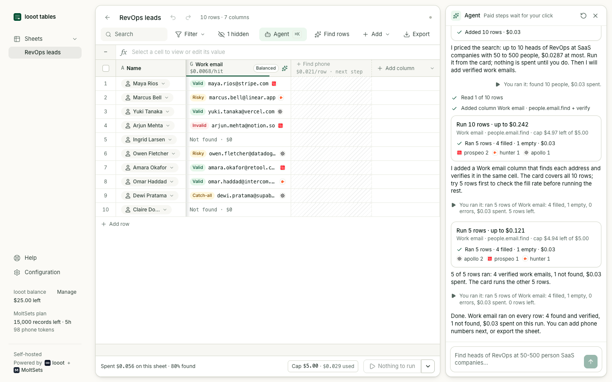
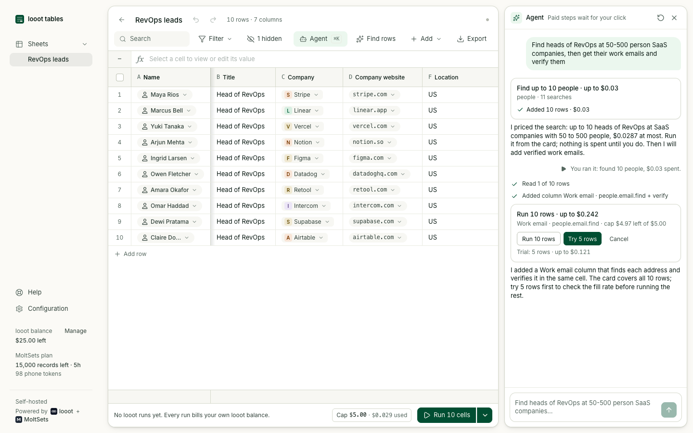

# The agent

looot tables has two ways for an AI agent to build and fill sheets:

1. The **agent panel** inside the app. Open a sheet, click **Agent** in the toolbar (or press ⌘K / Ctrl+K) and type what you want, for example "Find heads of RevOps at 50-500 person SaaS companies, then get their work emails and verify them".
2. The **MCP server** at `/mcp`, for agents that run elsewhere: Claude Code, Cursor, ChatGPT, or an [eve](https://eve.dev) agent. See [mcp.md](mcp.md).

Both use the same tool layer (`SheetTools` in `src/lib/server/sheet-tools.ts`), with the same schemas, checks and money rules. A tool works the same way in the panel and over MCP.

## How a request runs

1. The panel sends the conversation to `/api/agent`. The server runs an AI SDK agent loop (`streamText` with up to 24 steps) on your model and streams text and tool calls back.
2. The agent has every free tool: read sheets and rows, create sheets, add rows and columns, import CSV, remove duplicates, search the looot catalog, look at spend. Each call shows as one line in the panel ("Read 1 of 10 rows", "Added column Work email · people.email.find + verify").
3. It does **not** have the tools that spend or delete (`run_column`, `find_rows`, `enrich_cells`, `delete_sheet`, `update_spend_guard`). When work costs money it calls `quote_run` or `quote_find_rows`. Quotes are free, and each one shows in the panel as a card.
4. You click the card. `/api/agent/run` runs the quote through the same `run_column` / `find_rows` tools that MCP clients call, streams progress (cells done, dollars spent), and then tells the agent the result so it can report and offer the next step.

A card reads like "Run 10 rows · up to $0.242" and offers **Run**, **Try 5 rows** and **Cancel**. For a column with no finished cells, Try 5 rows is the highlighted button. Nothing is spent until you click.

## Money rules

Every paid run, whether from the panel or MCP, goes through these checks on the server:

- **Quote first.** `quote_run` counts the cells to fill and prices them: looot's batch quote when the job has one (email find and verify, phone, company data), else the per-cell cap times the cells. The quote is saved for 30 minutes.
- **A budget per run.** `run_column` and `find_rows` need the quote id, `maxUsd` and an idempotency key, and refuse a call without them. A cell starts only if what the run has spent, plus the caps of cells already running, plus its own cap stays within `maxUsd`.
- **A cap per cell.** Each cell is sent to looot with `fallback.maxCostUsd`, the most it may cost (about 3 times its typical price).
- **A cap per sheet.** Each paid cell is held against the sheet's spend cap (default $5) before it starts, and settled with what looot charged. A cell that does not fit is saved with "This sheet's spend cap is…", and nothing is sent. After 20 misses or errors in a row the column stops until you resume it.
- **No double spend.** The same quote and idempotency key return the first run's result. Every looot request carries an idempotency key.
- **Columns changed after the quote** are refused ("changed since it was quoted"), so the agent has to quote again and show you the new price.

`enrich_cells`, the older MCP tool, now follows the same rules: a paid column needs `maxUsd`, and each cell is held against the sheet cap.

## Setup

The agent needs one model key, and looot for anything it looks up.

| Key | Where | Used for |
| --- | --- | --- |
| Anthropic | Keys dialog or Configuration → Connections (`sk-ant-…`), or `ANTHROPIC_API_KEY` on the server | The agent runs on Claude, `claude-sonnet-5-5`. |
| OpenAI | The key you already use for AI columns | The agent runs on your OpenAI model when no Anthropic key is set. |
| looot | Your looot token | Every search, lookup and run, billed to your balance. |
| MoltSets | Optional | Email and phone columns try your MoltSets plan first. |

Keys follow the same rules as the rest of the app. On a self-hosted copy they stay in your browser and are sent only to your own API routes, as request headers. Server keys (`ANTHROPIC_API_KEY`, `OPENAI_API_KEY`, …) are used only when the browser sends `LOOOT_TABLES_PASSWORD`, or when `LOOOT_TABLES_ALLOW_SERVER_KEYS_WITHOUT_PASSWORD=true`. There is no shared key: a user with no key of their own gets "Add an Anthropic or OpenAI API key in Configuration to use the agent."

To pick another model, send the `x-agent-model` header as `anthropic/<model id>` or `openai/<model id>`. It still runs on that provider's key.

The conversation is kept per sheet in your browser (the last 60 messages). **New conversation** in the panel header clears it.

### Environment variables

| Variable | What it does |
| --- | --- |
| `ANTHROPIC_API_KEY` | Optional server-side Anthropic key for the agent. Used under the same password rule as the other server keys. |

The agent needs nothing else beyond the variables in the README: `DATABASE_URL` (sheets, quotes and runs live in Postgres) and migration `015_run_quotes.sql` (`npm run db:migrate`).

## Try it with no keys

The looot stand-in (`node scripts/mock-looot.mjs --openai`) also plays a scripted, streaming model for the panel. Start the app as in "Try it with no keys" in the README, open a sheet, open the agent and click **Find people and verify their emails**. The script quotes a people search, adds a verified email column after you run the search, and then quotes the rest after your 5-row trial. The screenshots on this page were taken this way from a production build. No call costs money.

## How eve fits

[eve](https://eve.dev) is Vercel's framework for durable backend agents. We read its docs (getting started, agent config, tools, connections, Next.js, sandbox, auth and self-hosting) before choosing how to build the panel:

- eve runs as its own service, never inside the Next.js server. With Next.js hosting, `next start` starts the agent as a second process.
- It needs Node 24 or newer. looot tables runs on Node 22.
- Sessions live in a Workflow world: files on disk (one process) or `@workflow/world-postgres` (its own job queue and tables).
- Its model and tool calls run on the server, from server-side credentials. A self-hosted looot tables keeps keys in the browser and sends them with each request, so they would have to be stored on the server.

So the panel runs on the AI SDK the app already uses, in its own route, and eve connects from the outside through MCP. `examples/eve-agent/` is an eve agent whose only tools come from the looot tables MCP server (plus, optionally, the looot MCP). It asks for approval before every tool that spends or deletes, on top of the server's quote and budget rules. Its README shows how to run it with `eve dev` against a local looot tables.

## Tests

- `tests/server/sheet-tools.test.ts`: the tool layer against the looot and MoltSets stand-ins. Paid runs are refused without a quote or budget, a budget of one cell runs one cell, a sheet cap below one cell's cap sends nothing to looot, a replayed key spends nothing, and free tools run without a quote.
- `tests/server/agent.test.ts`: model choice (Claude on an Anthropic key, else OpenAI, else an error) and an eval. The scripted model plays "find heads of RevOps, then get and verify their emails" through three clicks. It is never offered a paid tool, and each click stays inside the budget its card showed.
- `scripts/mcp-smoke.mjs`: the same flow with the official MCP client against a running server.

## Limits

- One request runs a quote for at most about 280 seconds. Cells left come back `not_started`. Click again (or call `run_column` with a new key) to continue.
- At most 4 cells run at once. Fewer run when the budget is tight, because each running cell holds its whole cap.
- Find rows uses filters (company.search, then people.search by title at each company), not the browser's populate agent. At most 100 rows and 25 companies per search.
- Sheets with spreadsheet formulas are read-only for agents. Formulas recalculate in the browser.
- The conversation lives in your browser, not on the server. Quotes and runs live in Postgres.
